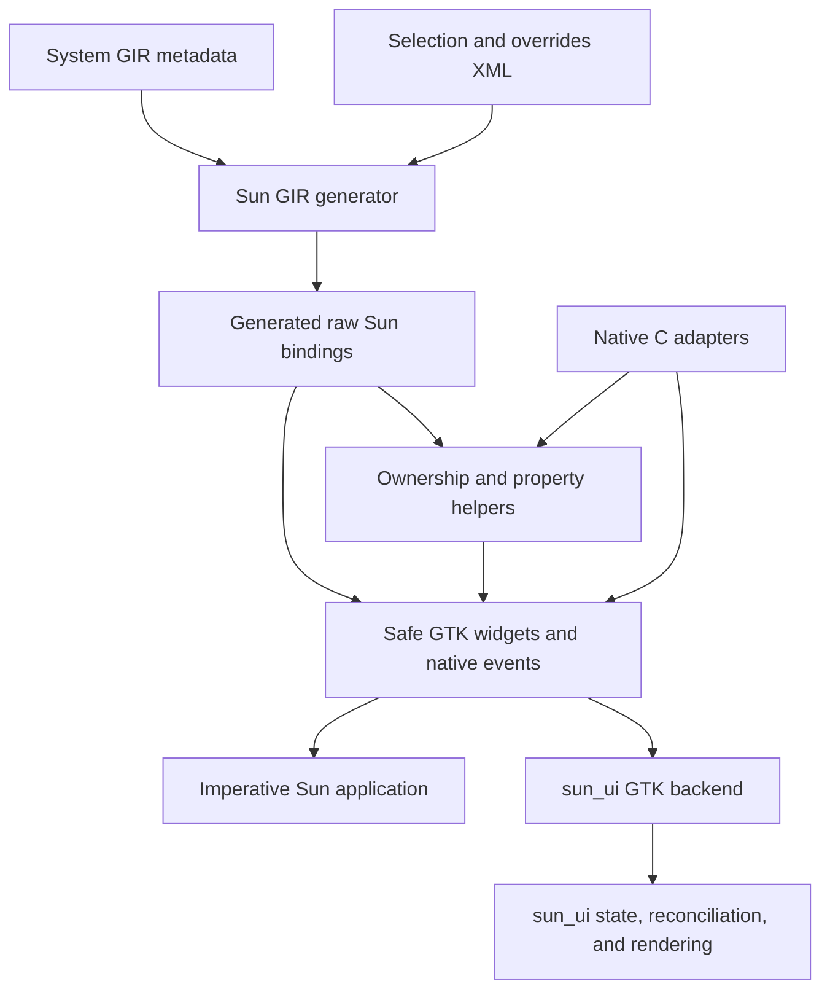

# sun_gobject

Sun-native bindings for GLib, GObject, GIO, and GTK4, with a GIR generator,
explicit ownership helpers, and a small safe GTK API. The GTK layer provides
applications, windows, buttons, box containers, native event queues, and timers
without requiring `unsafe` blocks in application code.

Support currently targets **native x86_64 Linux GNU and Apple Silicon macOS** and a curated subset of the
upstream APIs. General widget casts, arbitrary signals, captured closures,
custom subclasses, libadwaita, and cross-compilation are outside the current scope.

## Published development packages

Linux CI publishes `sun-gobject_0.dev_amd64.deb` to the `dev` release after tests
pass on `main`. The Ubuntu 26.04 package contains `sun_gobject.moon` and
`sun_gtk.moon` under `/usr/lib/sun`, the native static archive under
`/usr/lib/sun/native`, and license/compiler records under
`/usr/share/doc/sun-gobject`. Consumers can install or extract this package
without building the bindings from source. Use the compiler recorded in
`sun-version.txt` and matching UI bundles.

To package existing tested Linux build outputs, run `./scripts/package-linux.sh`.
The Apple Silicon release remains available as a separate macOS archive.

## Setup

Open the repository in its devcontainer and run all commands from the workspace
root:

```sh
./build.sh
./build/gtk-demo
```

The container includes the Sun dev release and matching standard library, LLVM 20,
CMake, Ninja, GTK4 development files, librsvg, GIR metadata, Xvfb, and D-Bus. `./build.sh`
builds the native libraries, generates bindings, compiles Sun artifacts, and runs
the full test suite. The demo needs a desktop display; headless tests use Xvfb.

For a host installation, install the dependencies listed in [Dockerfile](Dockerfile).
The build script installs Sun through `scripts/bootstrap-sun.sh` if it is absent.
Use `./scripts/bootstrap-sun.sh --update` to update the mutable dev release, or
`SUN_EXECUTABLE=/absolute/path/to/sun ./build.sh` to select an installation with a
matching standard library.

The current baseline is Sun `0.dev (fc9a5b23cc63)`. Recreating the devcontainer
updates the rolling development package; rebuild all bundles together after a
compiler update.

The bundle manifests declare stable library IDs: `namo-robotics/sun_gobject` and
`namo-robotics/sun_gtk`.
Keep these IDs unchanged when moving source files or renaming output bundles.
They identify the libraries independently of build paths; they do not guarantee
ABI compatibility across compiler or library changes.

For incremental development:

```sh
cmake -S native --preset dev-fast
cmake --build build/native -j$(($(nproc)/2))
sun tools/build.sun -- build
sun tools/build.sun -- test
```

Use the `dev-debug` preset for unoptimized native debugging. Run an individual
test with:

```sh
./scripts/sun-test-compiler.sh test tests/main.sun --test-filter generator_tests.valid_xml
```

## Key examples

### Integrate a UI framework

`gtk.EventQueue` provides FIFO native events without owning application state or
choosing render batches and shutdown policy. For example, after creating `app`
and `button`:

```sun
var events = try gtk.EventQueue(app);
var clicked = try events.on_clicked(button);
events.iterate(false);
var event = events.next();
```

`next()` returns `Option<gtk.NativeEvent>` with a kind and opaque registration ID.
The queue also supports `on_closed`, one-shot `after`, and `disconnect`. It retains
its sources and application, runs no application callbacks, and stays usable
without windows. Only one queue or callback loop may dispatch the default GTK
context at a time; dropping the queue cancels its sources and releases dispatch.

[sun_ui](https://github.com/namo-robotics/sun_ui) builds on these mechanisms to own
application state, semantic messages, view reconciliation, rendering, and lifecycle
policy. Its core remains independent of GTK.

### Handle a button click

Import `stdlib.moon`, `sun_gobject.moon`, and `sun_gtk.moon`. Keep owned widgets in
application state and register named callbacks with the optional imperative
`gtk.EventLoop<State>` convenience API:

```sun
/** Updates the button after native signal dispatch has returned. */
function clicked(state: ref AppState, context: ref gtk.EventContext<AppState>) SystemResult<void> {
  var greeting = String("Hello from Sun!");
  try state.button.set_label(greeting);
  return SystemResult.Ok;
}
```

After constructing the application and state, transfer the application into the
loop and borrow the state for the duration of `run()`:

```sun
var loop = gtk.EventLoop<AppState>(app);
var click_id = try loop.on_clicked(state.button, clicked);
try loop.run(state);
```

See [examples/gtk-demo.sun](examples/gtk-demo.sun) for the complete runnable program.
The loop also supports `on_closed`, one-shot timers with `after`, repeating timers
with `every`, and cancellation with `disconnect`. Callbacks can register work or
request `quit()` through their `EventContext`; staged changes take effect after
the callback succeeds. Dropping a registration ID does not disconnect it.

Run the demo's automated click-and-close scenario without a desktop:

```sh
GTK_A11Y=none GSK_RENDERER=cairo \
  dbus-run-session -- xvfb-run -a ./build/gtk-demo --self-test
```

### Build an installed consumer

Install the bundles and native adapter, then compile the demo against them:

```sh
sun tools/build.sun -- install "$PWD/dist"
sun --dynamic --path-var SUN_GOBJECT_BUILD="$PWD/dist/lib/sun" \
  --lib-path "$PWD/dist/lib/sun" \
  -L"$PWD/dist/lib" -l:libsun_gobject_native.a $(pkg-config --libs gtk4) \
  -c -o my-app examples/gtk-demo.sun
./my-app
```

Bundles must match the consumer's Sun compiler and platform. The project adapter
links statically; GTK and GLib remain shared system dependencies. No
`LD_LIBRARY_PATH` override is needed.

## High-level architecture

The build flows from system GIR metadata and reviewed XML configuration to raw
Sun bindings, then adds ownership helpers and the safe GTK layer.



| Component | Purpose |
| --- | --- |
| [`src/generator/`](src/generator/) | Read XML, load versioned GIR dependencies, translate supported C ABI types, and emit bindings. |
| [`bindings/`](bindings/) | Select supported declarations in `selection.xml` and apply explicit metadata corrections in `overrides.xml`. |
| [`src/support.sun`](src/support.sun) | Provide low-level reference ownership, property helpers, and signal connections. |
| [`src/gtk/`](src/gtk/) | Provide checked widgets, drawing surfaces, save dialogs, and native events, with at most one class per file. Shared declarations and helpers live in support files. |
| [`src/svg/`](src/svg/) | Own parsed librsvg documents and expose an explicit unsafe native render boundary, with separate document and viewport classes. |
| [`native/`](native/) | Implement C signal adapters, event storage, UTF-8 validation, and the platform main-thread guard. |
| [`tools/build.sun`](tools/build.sun) | Orchestrate generation, Sun compilation, tests, and installation. |
| [`tests/`](tests/) | Test the generator, runtime helpers, event loop, GTK demo, and an isolated installed consumer. |

Bundle manifests are maintained in `src/sun_gobject.sun` and `src/sun_gtk.sun`.
Update their source lists when adding or moving binding files. Generated Sun
bindings live in `src/generated/` and are ignored by Git. Reports live in
`build/generated/`; native build artifacts live in
`build/native/`. Reports include `coverage.tsv`, `gir-model.json`, and
`provenance.json`, which records compiler, generator, configuration, and GIR input
information. Generated sources are deterministic for identical inputs and options.

Raw declarations use `glib.raw`, `gobject.raw`, `gio.raw`, and `gtk.raw`, with opaque
object pointers. Only selected declarations are emitted; unsupported selected ABI
signatures fail generation. GIR ownership metadata does not automatically produce
safe wrappers. Low-level callers remain responsible for pointer validity, property
types, and transferred references.

The safe GTK layer owns native references, validates text and parenting, rejects
operations on closed windows, and enforces the platform main thread at runtime.
Native adapters queue events for Sun callbacks instead of storing Sun stack
pointers in GTK. The optional callback loop adds named handlers, deferred commands,
and automatic exit after its last window closes. It is single-use and cleans up
on exit; UI frameworks can use the native queue directly to define their own
policy. Registration and dispatch may allocate.

Compiler limitations and reproducible examples are recorded in
[sun_feedback.md](sun_feedback.md). Inspired by
[Ghostty's zig-gobject](https://github.com/ghostty-org/zig-gobject), with development
conventions from [Sun](https://github.com/namo-robotics/sun).

## Drawing and save dialogs

The `sun_gtk.moon` bundle includes `gtk.Label`, `gtk.DrawingArea`,
`gtk.SaveDialog`, and `svg.Document`. Link `librsvg-2.so.2` when using the SVG
wrappers, in addition to the existing GTK and native support libraries. The
platform-independent `sun_gobject.moon` bundle does not depend on librsvg or GTK.

`Box.append` accepts buttons, labels, drawing areas, and nested boxes. It rejects
existing parents and parenting cycles. Each wrapper owns its own native reference.
`Label.set_text` validates UTF-8 and embedded NUL bytes before changing the label.

Parse content with `svg.Document(content)` and pass it to
`DrawingArea.set_document(document)`. The area retains an independent reference;
the original document can then be released. Replacing a document releases the
previous callback's reference and clears render status. `rendered()` and
`render_failed()` report the latest native paint outcome. Widget operations and
destruction enforce the GTK main-thread rule. Native callbacks retain no Sun
references, application state, or closures.

`SaveDialog.show(window, title, filename)` opens one native save request.
After iterating the application's context, `take_path()` returns a selected local
path once, or `None` while pending or after cancellation. A non-local destination
returns an error. `cancel()` is idempotent; destruction also closes the dialog and
releases its retained parent. Text validation, closed parents, and duplicate
requests are checked before calling GTK. Applications remain responsible for
writing files and presenting success or error messages.

The checked `gtk.OpenDialog` and `gtk.SaveDialog` bindings own native file
choosers and expose selected local paths through polling. Both reject concurrent
requests and closed parents, and release pending requests on cancellation or
destruction. UI adapters can use these bindings without exposing native handles
to application state.

The declarative `gtk.Widget` media kind combines `GtkVideo` playback with an owned
timeline and draggable selection handles. Its checked methods validate ranges in
microseconds and expose copied range edits through `EventQueue`. Playback, seeking,
keyboard input, and frame drawing remain on the GTK thread. Unmapping pauses the
stream; destruction disconnects callbacks and releases it. GTK's GStreamer media
backend requires suitable codec packages, supplied by the development image.

## Apple Silicon macOS releases

The macOS workflow builds and tests native bundles with the Homebrew Sun compiler
and GTK, then publishes `sun_gobject-arm64-apple-darwin.tar.gz` to the
[dev release](https://github.com/namo-robotics/sun_gobject/releases/tag/dev)
on successful main builds. Run `./scripts/build-macos.sh` on an Apple Silicon Mac
with the dependencies listed in `.github/workflows/macos.yml`.

Archives include the compiler version used to build the bundles. Consumers must
use a compatible compiler and matching native dependencies; Linux bundles cannot
be reused on macOS. Intel macOS is not covered by these releases.
