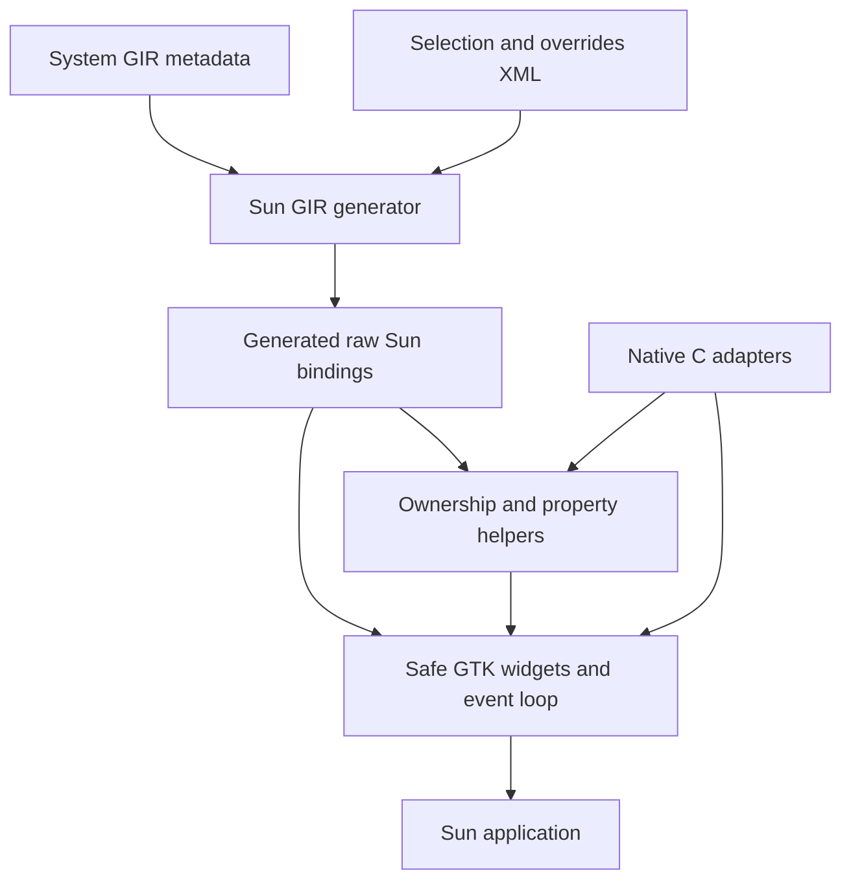

# sun_gobject

Sun-native bindings for GLib, GObject, GIO, and GTK4, with a GIR generator,
explicit ownership helpers, and a small safe GTK API. The GTK layer provides
applications, windows, buttons, named event callbacks, and timers without requiring
`unsafe` blocks in application code.

Support currently targets **native x86_64 Linux GNU** and a curated subset of the
upstream APIs. General widget casts, arbitrary signals, captured closures,
custom subclasses, libadwaita, and cross-compilation are outside the current scope.

## Setup

Open the repository in its devcontainer and run all commands from the workspace
root:

```sh
./build.sh
./build/gtk-demo
```

The container includes the Sun dev release and matching standard library, LLVM 20,
CMake, Ninja, GTK4 development files, GIR metadata, Xvfb, and D-Bus. `./build.sh`
builds the native libraries, generates bindings, compiles Sun artifacts, and runs
the full test suite. The demo needs a desktop display; headless tests use Xvfb.

For a host installation, install the dependencies listed in [Dockerfile](Dockerfile).
The build script installs Sun through `scripts/bootstrap-sun.sh` if it is absent.
Use `./scripts/bootstrap-sun.sh --update` to update the mutable dev release, or
`SUN_EXECUTABLE=/absolute/path/to/sun ./build.sh` to select an installation with a
matching standard library.

For incremental development:

```sh
cmake -S native --preset dev-fast
cmake --build build/native -j$(($(nproc)/2))
sun tools/build.sun -- build
sun tools/build.sun -- test
```

Use the `dev-debug` preset for unoptimized native debugging. Run an individual
test with:

```sh
./scripts/sun-test-compiler.sh test tests/main.sun --test-filter generator_tests.valid_xml
```

## Key examples

### Handle a button click

Import `stdlib.moon`, `sun_gobject.moon`, and `sun_gtk.moon`. Keep owned widgets in
application state and register named callbacks with `gtk.EventLoop<State>`:

```sun
/** Updates the button after native signal dispatch has returned. */
function clicked(state: ref AppState, context: ref gtk.EventContext<AppState>) SystemResult<void> {
  var greeting = String("Hello from Sun!");
  try state.button.set_label(greeting);
  return SystemResult.Ok;
}
```

After constructing the application and state, transfer the application into the
loop and borrow the state for the duration of `run()`:

```sun
var loop = gtk.EventLoop<AppState>(app);
var click_id = try loop.on_clicked(state.button, clicked);
try loop.run(state);
```

See [examples/gtk-demo.sun](examples/gtk-demo.sun) for the complete runnable program.
The loop also supports `on_closed`, one-shot timers with `after`, repeating timers
with `every`, and cancellation with `disconnect`. Callbacks can register work or
request `quit()` through their `EventContext`; staged changes take effect after
the callback succeeds. Dropping a registration ID does not disconnect it.

Run the demo's automated click-and-close scenario without a desktop:

```sh
GTK_A11Y=none GSK_RENDERER=cairo \
  dbus-run-session -- xvfb-run -a ./build/gtk-demo --self-test
```

### Build an installed consumer

Install the bundles and native adapter, then compile the demo against them:

```sh
sun tools/build.sun -- install "$PWD/dist"
sun --dynamic --path-var SUN_GOBJECT_BUILD="$PWD/dist/lib/sun" \
  --lib-path "$PWD/dist/lib/sun" \
  -L"$PWD/dist/lib" -l:libsun_gobject_native.a $(pkg-config --libs gtk4) \
  -c -o my-app examples/gtk-demo.sun
./my-app
```

Bundles must match the consumer's Sun compiler and platform. The project adapter
links statically; GTK and GLib remain shared system dependencies. No
`LD_LIBRARY_PATH` override is needed.

## High-level architecture

The build flows from system GIR metadata and reviewed XML configuration to raw
Sun bindings, then adds ownership helpers and the safe GTK layer.



| Component | Purpose |
| --- | --- |
| [`src/generator/`](src/generator/) | Read XML, load versioned GIR dependencies, translate supported C ABI types, and emit bindings. |
| [`bindings/`](bindings/) | Select supported declarations in `selection.xml` and apply explicit metadata corrections in `overrides.xml`. |
| [`src/support.sun`](src/support.sun) | Provide low-level reference ownership, property helpers, and signal connections. |
| [`src/gtk.sun`](src/gtk.sun) | Provide owned application, window, and button wrappers with checked operations. |
| [`src/events.sun`](src/events.sun) | Dispatch typed callbacks, deferred commands, and timers on the main thread. |
| [`native/`](native/) | Implement C signal adapters, event storage, UTF-8 validation, and the Linux main-thread guard. |
| [`tools/build.sun`](tools/build.sun) | Orchestrate generation, Sun compilation, tests, and installation. |
| [`tests/`](tests/) | Test the generator, runtime helpers, event loop, GTK demo, and an isolated installed consumer. |

Generated bindings and reports live in `build/generated/`; native build artifacts
live in `build/native/`. Reports include `coverage.tsv`, `gir-model.json`, and
`provenance.json`, which records compiler, generator, configuration, and GIR input
information. Generated sources are deterministic for identical inputs and options.

Raw declarations use `glib.raw`, `gobject.raw`, `gio.raw`, and `gtk.raw`, with opaque
object pointers. Only selected declarations are emitted; unsupported selected ABI
signatures fail generation. GIR ownership metadata does not automatically produce
safe wrappers. Low-level callers remain responsible for pointer validity, property
types, and transferred references.

The safe GTK layer owns native references, validates text and parenting, rejects
operations on closed windows, and enforces the initial Linux thread at runtime.
Native adapters queue events for Sun callbacks instead of storing Sun stack
pointers in GTK. Event loops are single-use and release registrations, timers,
and queued work when they exit. Registration and dispatch may allocate.

Compiler limitations and reproducible examples are recorded in
[sun_feedback.md](sun_feedback.md). Inspired by
[Ghostty's zig-gobject](https://github.com/ghostty-org/zig-gobject), with development
conventions from [Sun](https://github.com/namo-robotics/sun).
